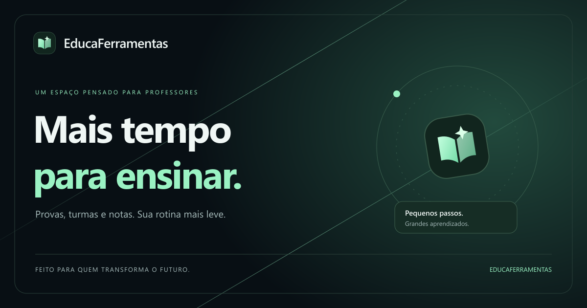

# EducaFerramentas

**Mais tempo para ensinar.**

O EducaFerramentas é um projeto que busca deixar a rotina de professores mais leve. A proposta é reunir a preparação de provas e o acompanhamento de turmas em um espaço bonito, simples e organizado, acessível pelo navegador.

👉 **[Acessar o EducaFerramentas](https://marcospaulobds.github.io/EducaFerramentas/)**

## Um espaço para o seu trabalho

- **Prepare suas provas:** escreva questões e alternativas, escolha se deseja embaralhá-las e imprima a avaliação e o gabarito separadamente.
- **Organize suas turmas:** cadastre turmas e alunos e encontre seus registros em um só lugar.
- **Acompanhe as notas:** registre até seis avaliações por aluno, defina os pesos e consulte a média ponderada.
- **Continue em outro dispositivo:** entre na sua conta para abrir o trabalho que você salvou.
- **Escolha sua atmosfera:** use os temas Aurora, Cosmos, Oceano, Amanhecer ou Alto contraste. Ajuste o texto e desative as animações se preferir.

As ferramentas exigem uma conta. Salve suas alterações antes de sair; ao continuar em outro dispositivo, atualize e abra os registros desejados.

## Por que este projeto existe?

Preparar avaliações, organizar turmas e acompanhar notas faz parte do trabalho de ensinar — mas também consome tempo. O EducaFerramentas nasce da vontade de simplificar essas tarefas e abrir mais espaço para o cuidado com o aprendizado.

O projeto integra o Trabalho Final da **Atividade Extensionista II da UNINTER**, com o tema *Modernizar o Ensino com Inteligência Artificial*. Está em desenvolvimento e pode evoluir a partir das experiências e sugestões de professores.

## Última atualização · 03/11/2026

- Avisos de acesso junto ao formulário, com orientações para resolver erros; mínimo de seis caracteres para criar ou redefinir a senha.
- Sugestões de questões com IA ativadas, com revisão antes de adicionar e edição de questões na prova.
- Nova identidade visual, com menu inferior e fundos luminosos suaves.
- Cinco temas e preferências de leitura.
- Login obrigatório nas ferramentas e integração de contas para salvar o trabalho.
- Imagens de compartilhamento e ícones próprios em todas as páginas.
- Primeiros cuidados de acessibilidade: foco visível, navegação por teclado, alto contraste e redução de movimento.

## O que vem depois?

- Ampliar os testes das sugestões de IA em português e da qualidade pedagógica.
- Mais opções de edição de questões e organização de avaliações.
- Boletins e formas mais completas de acompanhar o desempenho.
- Testes com professores, leitores de tela e diferentes dispositivos.
- Novas melhorias de acessibilidade a partir do uso real.

## Um projeto em construção

Esta é uma versão acadêmica em evolução. A geração por IA já está ativada e passou por um primeiro teste real. As sugestões podem conter erros e precisam da revisão do professor. O usuário responsável já experimentou o cadastro e o acesso, inclusive no celular; a recuperação completa de senha continua em validação.

Durante os testes, use **dados fictícios de alunos**. A experiência em TVs, consoles e tecnologias assistivas será refinada com testes nesses equipamentos; não há garantia de compatibilidade com todos os navegadores.

---

Desenvolvido por **Marcos Paulo B. da Silva** · EducaFerramentas · 2026
